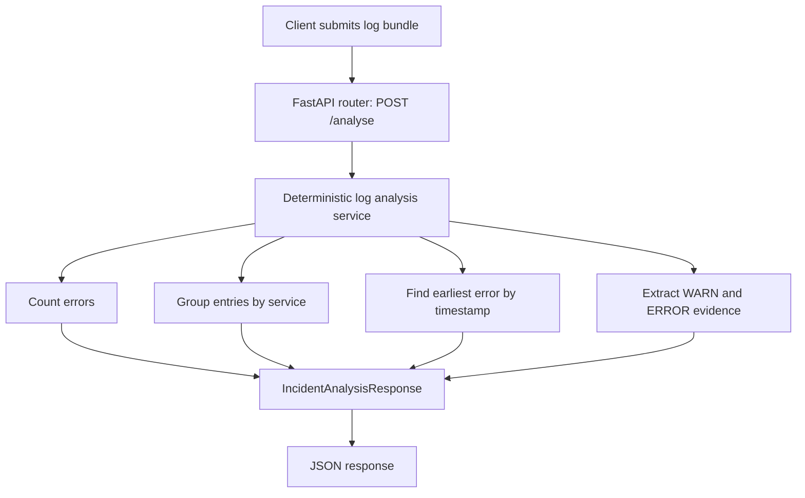
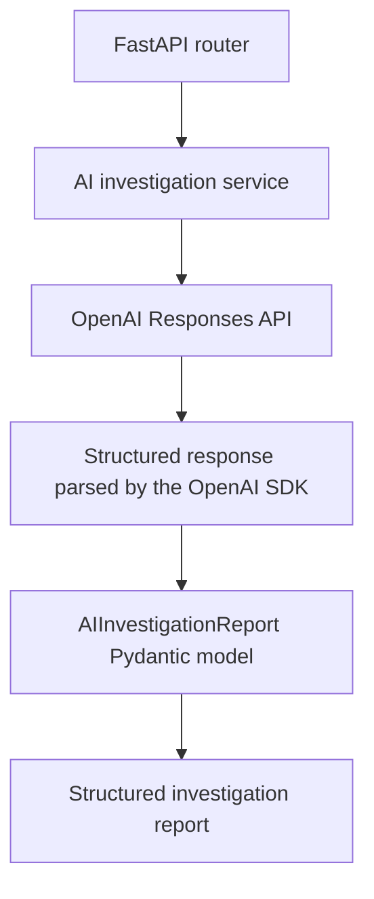

# AI Incident Investigator

An AI-powered developer tool for investigating application incidents from logs and technical evidence. The project is being built incrementally as a portfolio project while learning Applied AI Engineering.

The goal is to help engineers understand production failures by summarising symptoms, identifying plausible causes, citing relevant log evidence, suggesting investigation steps, and being explicit about uncertainty.

> **Project status:** The FastAPI backend currently provides deterministic log analysis. A standalone script also calls the OpenAI Responses API and requests a Pydantic-backed structured investigation report. The AI call has **not yet been integrated into the `/analyse` endpoint**.

## Current capabilities

- FastAPI application with `GET /health` and `POST /analyse`.
- Pydantic request and response models.
- Deterministic log analysis to count errors, group entries by service, find the earliest error by timestamp, and extract warning/error entries as potential supporting evidence.
- Synthetic database connection-pool-exhaustion incident data.
- Separate ground-truth data for testing; it should not be supplied to the model as incident input.
- Tests for analysis functions, malformed entries, timestamp ordering, evidence selection, and endpoint behaviour.
- A standalone OpenAI SDK connection check and a standalone structured-investigation script using the Responses API.

## Technology stack

- **Python**
- **FastAPI** and **Uvicorn** for the API
- **Pydantic** for request, response, and AI report models
- **uv** for Python project/dependency management
- **pytest** and FastAPI `TestClient` for tests
- **OpenAI Python SDK** and the **Responses API** for the initial AI experiment
- **Angular** is the planned frontend; it has not been started yet.

## Architecture

### Current deterministic API flow

The API currently uses deterministic Python functions. It does not call an LLM when `POST /analyse` is requested.



### Target AI investigation flow

This is the next integration step. The standalone script already demonstrates the OpenAI call and parsed report, but the API router is not yet connected to the AI investigation service.



The `AIInvestigationReport` model defines the expected output fields:

- `summary`
- `likely_root_cause`
- `supporting_evidence`
- `alternative_hypotheses`
- `recommended_next_steps`
- `uncertainties`

A valid schema does not guarantee a correct diagnosis. Evidence grounding, uncertainty handling, and diagnosis quality need to be tested separately.

## Project structure

```text
ai-incident-investigator/
├── src/
│   └── ai_incident_investigator/
│       ├── main.py
│       ├── routers/
│       │   └── incidents.py
│       ├── models/
│       │   ├── incident.py
│       │   └── ai_investigation.py
│       ├── services/
│       │   └── log_analysis.py
│       └── data/
│           ├── incidents.py
│           └── ground_truth.py
├── scripts/
│   ├── test_openai_connection.py
│   └── test_structured_investigation.py
├── tests/
│   ├── test_main.py
│   ├── test_log_analysis.py
│   └── test_incidents.py
├── .env                 # Local only; never commit
├── .gitignore
├── pyproject.toml
├── uv.lock
└── README.md
```

This is a guide to the intended/current working layout; update it when files are added, removed, or renamed.

## Prerequisites

- Python version supported by `pyproject.toml` (currently Python 3.13 or later).
- [`uv`](https://docs.astral.sh/uv/) installed.
- An OpenAI API key for the standalone AI scripts. API usage is billed separately from a ChatGPT subscription and may incur charges.

## Setup

From the repository root:

```bash
uv sync
```

Create a local `.env` file in the repository root with your API key:

```dotenv
OPENAI_API_KEY=your_actual_api_key_here
```

Replace the placeholder with your own key. Never commit `.env` or paste the key into source code, logs, issues, or chat messages. The repository's `.gitignore` should include:

```gitignore
.env
```

Confirm that Git ignores the file:

```bash
git check-ignore -v .env
```

You can verify that `uv` loads the key without printing the secret:

```bash
uv run --env-file .env python -c "import os; print('API key loaded' if os.getenv('OPENAI_API_KEY') else 'API key missing')"
```

## Useful commands

Run these commands from the repository root.

### Install/synchronise dependencies

```bash
uv sync
```

Add a dependency (example):

```bash
uv add openai
```

### Run the tests

```bash
uv run pytest
```

Run a specific test file:

```bash
uv run pytest tests/test_log_analysis.py
uv run pytest tests/test_main.py
```

### Start the FastAPI development server

Load `.env` for the server process:

```bash
uv run --env-file .env fastapi dev
```

Then open:

- Interactive API docs: <http://127.0.0.1:8000/docs>
- Health endpoint: <http://127.0.0.1:8000/health>

Use `POST /analyse` in `/docs` to submit a JSON request such as:

```json
{
  "log_text": "2026-10-09T10:00:03Z WARN payment-service Database connection pool at capacity active=20 max=20\n2026-10-09T10:00:04Z ERROR payment-service Database connection timeout request_id=req-102"
}
```

The current endpoint returns deterministic analysis; it is not yet using OpenAI.

### Check OpenAI SDK connectivity

```bash
uv run --env-file .env python scripts/test_openai_connection.py
```

This makes a real API request. It verifies that the SDK can access the API using the configured key, but it is not an automated unit test and may incur usage charges.

### Generate a structured investigation report

```bash
uv run --env-file .env python scripts/test_structured_investigation.py
```

This standalone experiment sends the synthetic database-pool-exhaustion logs to the Responses API and parses the result into `AIInvestigationReport`. It is not yet invoked by `POST /analyse`.

## Synthetic incidents and ground truth

The first incident models database connection-pool exhaustion using synthetic log entries. Its expected root cause and related evaluation notes are held separately from the log bundle in the ground-truth data module.

Ground truth is for tests and evaluation. Do not include it in the model's input when investigating that incident; otherwise, the test would reveal the answer to the model.

Potential later scenarios include expired credentials, downstream timeouts, deployment regressions, memory leaks, database migration failures, queue backlogs, and unavailable service dependencies.

## Current limitations and engineering principles

- The deterministic analysis uses explicit rules and does not establish causation.
- Warning/error entries selected as evidence are _potentially relevant_; selection alone does not prove they support a particular hypothesis.
- The standalone AI report can be structurally valid while its diagnosis or recommendations are wrong.
- Supporting evidence is instructed to use exact supplied log lines, but automatic verification of every AI-cited line against the input has not yet been added.
- Missing evidence should result in stated uncertainty rather than unsupported certainty.
- Live OpenAI requests should not be required for the ordinary unit-test suite. AI service tests should use mocks or another controlled approach.
- Keep secrets out of source control and keep ground truth separate from model input.

## Roadmap

1. Finish strengthening the deterministic baseline and its tests.
2. Move the standalone Responses API call into a dedicated AI investigation service.
3. Integrate AI investigation into the FastAPI backend incrementally.
4. Add reliable handling for API errors and responses that do not contain a parsed report.
5. Test the AI service without making every test call OpenAI.
6. Compare outputs with the synthetic ground truth and develop a repeatable evaluation approach.
7. Build the Angular interface once the backend workflow is stable.
8. Consider retrieval over documentation/runbooks, broader datasets, observability, security, and deployment when the relevant learning modules are reached.

## Development workflow

Work on a feature branch for the OpenAI integration, keep changes small, and run `uv run pytest` before committing. Never commit `.env` or any real API key. Update this README as commands, architecture, and project status change.
