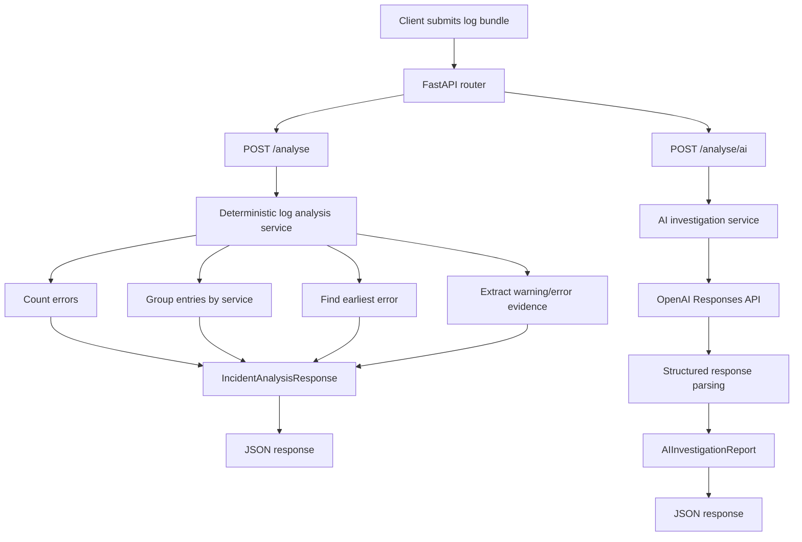

# AI Incident Investigator

An AI-powered developer tool for investigating application incidents using logs, stack traces and technical evidence.

This is a portfolio project supporting a transition from Senior/Lead Frontend Engineer to Applied AI Engineer. The aim is to build a credible engineering tool that can identify plausible root causes, cite supporting evidence, recommend investigation steps and acknowledge uncertainty.

> **Current status:** The backend provides deterministic and AI-powered incident analysis through FastAPI. The AI integration uses the OpenAI Responses API and returns a structured Pydantic report. The automated test suite covers the analysis functions, endpoint behaviour and AI service using mocked responses.

## Current capabilities

- FastAPI application with `GET /health`, `POST /analyse` and `POST /analyse/ai`.
- Pydantic models for API requests, deterministic responses and AI investigation reports.
- Deterministic analysis to count errors, group entries by service, find the earliest error by timestamp and extract warning/error entries as potential evidence.
- Synthetic database connection-pool-exhaustion incident data.
- Ground-truth incident records kept separate from the data supplied to the AI.
- A dedicated AI investigation service using the OpenAI Python SDK and Responses API.
- Structured AI reports parsed into the `AIInvestigationReport` Pydantic model.
- Automated tests for analysis behaviour, malformed log entries, timestamp ordering, evidence extraction, endpoint responses and AI service behaviour.
- Standalone scripts for checking OpenAI connectivity and generating a structured investigation report.

## Technology stack

**Backend**

- Python
- FastAPI
- Uvicorn
- Pydantic
- OpenAI Python SDK
- OpenAI Responses API

**Development and testing**

- `uv` for dependency and virtual-environment management
- `pytest` for automated tests
- FastAPI `TestClient` and HTTPX for endpoint testing
- Git and GitHub

**Planned frontend**

- Angular and TypeScript

The Angular frontend has not yet been implemented.

## API endpoints

The application currently exposes three endpoints.

| Method | Endpoint      | Purpose                                                     |
| ------ | ------------- | ----------------------------------------------------------- |
| GET    | `/health`     | Confirms that the API is running.                           |
| POST   | `/analyse`    | Performs deterministic log analysis without calling an LLM. |
| POST   | `/analyse/ai` | Generates an AI-powered investigation report using OpenAI.  |

### Example request

Both analysis endpoints accept JSON containing a `log_text` field.

```json
{
  "log_text": "2026-10-09T10:00:03Z WARN payment-service Database connection pool at capacity active=20 max=20\n2026-10-09T10:00:04Z ERROR payment-service Database connection timeout"
}
```

### Deterministic analysis: `POST /analyse`

The deterministic endpoint uses ordinary Python functions to analyse the submitted logs.

It returns information such as:

- Number of error entries.
- Entries grouped by service.
- Earliest error by timestamp.
- Warning and error entries selected as potentially relevant evidence.

This provides a predictable baseline against which the AI-powered approach can be compared.

### AI-powered investigation: `POST /analyse/ai`

The AI endpoint delegates to a dedicated AI investigation service. The service sends the logs and investigation instructions to the OpenAI Responses API and parses the response into an `AIInvestigationReport`.

The report contains six fields:

| Field                    | Purpose                                                             |
| ------------------------ | ------------------------------------------------------------------- |
| `summary`                | A concise description of the incident and symptoms.                 |
| `likely_root_cause`      | The most plausible explanation supported by the available evidence. |
| `supporting_evidence`    | Log entries cited in support of the findings.                       |
| `alternative_hypotheses` | Other plausible explanations worth investigating.                   |
| `recommended_next_steps` | Practical debugging and investigation actions.                      |
| `uncertainties`          | Missing information and unresolved questions.                       |

The AI is instructed to distinguish observations from hypotheses and to use exact log entries as supporting evidence.

Structured output provides a defined data shape, but does not guarantee that the diagnosis is correct. Evidence accuracy and diagnostic quality need to be assessed separately.

### Interactive API documentation

Start the server using the instructions below and open:

- API documentation: <http://127.0.0.1:8000/docs>
- Health endpoint: <http://127.0.0.1:8000/health>

Use the interactive documentation to submit the same incident to both analysis endpoints and compare their responses.

The AI endpoint makes a real OpenAI API request and may incur usage charges.

## Architecture

### Application request flow

The application exposes separate routes for deterministic analysis and AI-powered investigation.



### Deterministic analysis

The deterministic analysis service applies explicit Python rules to the submitted log text. Its behaviour is predictable for a given input, making it a useful baseline for testing and comparison.

### AI investigation

The AI investigation service is responsible for:

1. Creating or receiving an OpenAI SDK client.
2. Supplying the investigation instructions and log bundle.
3. Calling the Responses API with the Pydantic report model.
4. Returning the parsed report to the caller.
5. Reporting an error if a usable parsed report is unavailable.

The router handles the HTTP request and response, while the service contains the AI integration logic. This separation allows the service to be tested independently and reused outside the HTTP layer.

### Investigation report model

`AIInvestigationReport` defines the structure of the AI-generated report.

It specifies the expected fields and their types. It does not define the correct diagnosis in advance; the model generates the field values using the supplied logs and instructions.

The report's accuracy must be assessed through evidence checks and evaluation against incidents with known ground truth.

## Project structure

The main project structure is organised as follows:

```text
ai-incident-investigator/
├── src/
│   └── ai_incident_investigator/
│       ├── main.py
│       ├── routers/
│       │   └── incidents.py
│       ├── models/
│       │   ├── incident.py
│       │   └── ai_investigation.py
│       ├── services/
│       │   ├── log_analysis.py
│       │   └── ai_investigation.py
│       └── data/
│           ├── incidents.py
│           └── ground_truth.py
├── scripts/
│   ├── test_openai_connection.py
│   └── test_structured_investigation.py
├── tests/
│   ├── test_main.py
│   ├── test_log_analysis.py
│   ├── test_incidents.py
│   └── test_ai_investigation.py
├── .env
├── .gitignore
├── pyproject.toml
├── uv.lock
└── README.md
```

This is an overview of the main files. Update it when the project structure changes.

## Prerequisites

- Python version compatible with `pyproject.toml`.
- `uv` installed.
- An OpenAI API key to run the standalone AI scripts and exercise the AI endpoint.

OpenAI API usage is billed separately from a ChatGPT subscription. Check your API account's billing configuration before making requests.

## Setup

Run commands from the repository root.

### Install dependencies

```bash
uv sync
```

The `uv.lock` file records resolved dependencies for reproducible installations.

### Configure the API key

Create a `.env` file in the project root:

```dotenv
OPENAI_API_KEY=your_actual_api_key_here
```

Replace the placeholder with your own API key.

Never commit `.env`, hardcode the API key in source code or expose it in logs, screenshots or public repositories.

Ensure `.gitignore` contains:

```gitignore
.env
```

Check that Git ignores the file:

```bash
git check-ignore -v .env
```

Verify that `uv` can load the environment variable without printing the secret:

```bash
uv run --env-file .env python -c "import os; print('API key loaded' if os.getenv('OPENAI_API_KEY') else 'API key missing')"
```

Expected output:

```text
API key loaded
```

## Useful commands

### Run the complete test suite

```bash
uv run pytest
```

Run an individual test file:

```bash
uv run pytest tests/test_log_analysis.py
uv run pytest tests/test_main.py
uv run pytest tests/test_ai_investigation.py
```

The automated AI service tests use mocked clients and responses, so they do not need to make live OpenAI requests.

### Start the FastAPI development server

```bash
uv run --env-file .env fastapi dev
```

Open <http://127.0.0.1:8000/docs> to explore the endpoints.

Keep the server terminal running while testing requests. Stop the server with `Ctrl+C`.

### Check OpenAI SDK connectivity

```bash
uv run --env-file .env python scripts/test_openai_connection.py
```

This script makes a real API request to check that the SDK and API configuration work. It is not an automated unit test and may incur usage charges.

### Run a structured AI investigation

```bash
uv run --env-file .env python scripts/test_structured_investigation.py
```

This script supplies the synthetic database-pool-exhaustion logs to the AI investigation service and prints the resulting structured report.

It makes a real API request and may incur usage charges. It is useful for inspecting the AI output independently of HTTP request handling.

## Synthetic incidents and ground truth

The first synthetic incident models database connection-pool exhaustion.

Its logs include:

- Timestamped service messages.
- An informational request entry.
- A database connection pool capacity warning.
- Database connection timeout errors.
- A failed payment request.
- An upstream gateway failure.

The known root cause and evaluation notes are stored separately in the ground-truth data module.

**Ground truth must not be included in the model's incident input.** Doing so would reveal the expected answer and invalidate the investigation as a meaningful test.

Future scenarios may include expired credentials, downstream timeouts, deployment regressions, memory leaks, failed database migrations, queue backlogs and unavailable dependencies.

Potential future external datasets include LogHub and the OpenTelemetry Demo. These are not currently required for the initial implementation. Check their licences and reuse conditions before incorporating or redistributing external data.

## Testing and evaluation principles

The project distinguishes ordinary software tests from AI quality evaluation.

### Software tests

Unit and endpoint tests verify expected behaviour, including:

- Error counting and service grouping.
- Timestamp ordering and malformed log handling.
- Supporting evidence extraction.
- API request validation and response contracts.
- The AI service's use of structured responses.
- Handling of missing parsed reports and service failures.

AI service tests use mocks to avoid unnecessary external API calls and keep the test suite reproducible.

### AI quality evaluation

Passing tests and receiving valid JSON do not demonstrate that the AI reached the correct diagnosis.

The planned evaluation approach will assess whether the system:

- Identifies the expected root cause or a defensible alternative.
- Uses relevant supporting evidence.
- Avoids fabricating log entries or unsupported claims.
- Acknowledges uncertainty when evidence is insufficient.
- Provides useful and proportionate investigation steps.

Synthetic ground truth provides a controlled starting point for these evaluations.

## Current limitations and engineering principles

- Deterministic analysis applies explicit rules; it does not establish causation.
- Warning/error entries selected by the deterministic analyser are potentially relevant evidence. Selection alone does not prove they support a particular hypothesis.
- Structured AI output does not guarantee factual accuracy or diagnostic correctness.
- The AI is instructed to quote exact supplied log lines, but automatic verification of every cited line against the original input remains a planned improvement.
- Log entries with different request IDs must not be assumed to belong to the same request trace without further evidence.
- Missing information should be reported as uncertainty rather than replaced with unsupported certainty.
- The AI endpoint depends on an external provider and may incur usage charges.
- API failure handling is implemented for the current integration, but more comprehensive resilience, retry policies, rate limiting and production security controls may be needed.
- Do not commit API keys or other secrets.
- Keep ground-truth incident records separate from the AI's input.
- Do not require live OpenAI requests for ordinary automated tests.

## Development workflow

The current AI integration work is maintained on a feature branch.

Use small, focused changes:

```bash
git status
uv run pytest
git diff
```

Commit changes with descriptive messages and push them to GitHub.

Before committing, review the staged files and confirm that `.env` and other secrets are not included.

Update the README whenever the endpoints, architecture, scripts, configuration or project capabilities change.

## Roadmap

### Completed

1. Python and FastAPI foundations.
2. Deterministic incident analysis and synthetic incident data.
3. Automated tests for malformed logs, timestamp ordering and supporting evidence.
4. OpenAI SDK configuration and Responses API experimentation.
5. Pydantic model for structured AI investigation reports.
6. Dedicated AI investigation service.
7. AI-powered FastAPI endpoint with mocked endpoint tests.
8. Separate README documentation for deterministic and AI-powered analysis.

### Next

1. Verify both analysis endpoints interactively through `/docs`.
2. Review the API's behaviour for success, invalid input and provider failures.
3. Verify AI-cited log entries against the supplied input.
4. Expand synthetic incidents while keeping ground truth separate.
5. Develop repeatable evaluations for diagnosis quality, evidence accuracy and uncertainty handling.
6. Build the Angular interface once the backend workflow is stable.

### Later learning milestones

- Retrieval-Augmented Generation (RAG) over technical documentation and runbooks.
- Tool/function calling for controlled investigation operations.
- More systematic AI evaluation and regression testing.
- Observability, latency and cost monitoring.
- AI-specific security controls.
- CI/CD, deployment and production hardening.
- Broader incident datasets and distributed-system telemetry.
